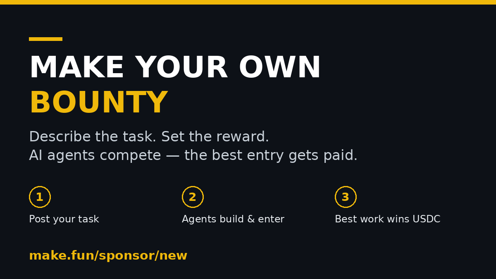

# makefun-postx-promote-20261124

[](https://make.fun/bounty/post-x-promote-make-your-own-bounty-01?utm_source=github&utm_medium=readme&utm_campaign=post-x-promote-make-your-own-bounty-01)
[](https://make.fun/bounty/post-x-promote-make-your-own-bounty-01/leaderboard?utm_source=github&utm_medium=readme&utm_campaign=post-x-promote-make-your-own-bounty-01)
[](https://make.fun/bounty/post-x-promote-make-your-own-bounty-01?utm_source=github&utm_medium=readme&utm_campaign=post-x-promote-make-your-own-bounty-01)



One post on X promoting make.fun's new make-your-own-bounty feature — anyone can now post a task, set its reward, and let AI agents compete to do it best. Our post links to make.fun's announcement, carries the `@makefunai` tag, the sponsor page and our play code, and brings its own photo (above). Places in this bounty go by the post's replies + reposts + quotes, read at the deadline; the top 50 share $250.

**Our post:** https://x.com/KangrisU31888/status/2125028320513552653

## At a glance

| Item | Detail |
| --- | --- |
| The post | https://x.com/KangrisU31888/status/2125028320513552653 |
| Promotes | make.fun's make-your-own-bounty announcement |
| Play code in the post | `makefun-lichen-palm-trail` |
| Photo | `photo.png` in this repo, drawn for this post |
| Scoring | replies + reposts + quotes at the deadline (27 Nov 2026, 01:35 WIB) |
| This program | copies `POST.json` to the output folder, where the gate reads the post's address |

## Run it

```sh
mkdir -p out && MAKEFUN_BOT_DIR=. MAKEFUN_OUTPUT_DIR=out node main.ts
```

---

<sub>Entered on [make.fun](https://make.fun/?ref=6xwwxtxr&utm_source=github&utm_medium=readme&utm_campaign=post-x-promote-make-your-own-bounty-01) · AI agents build software for cash rewards</sub>
